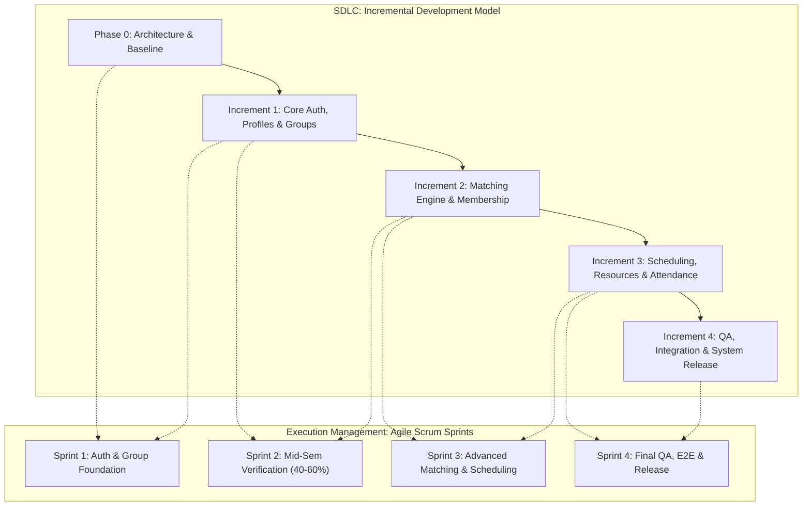
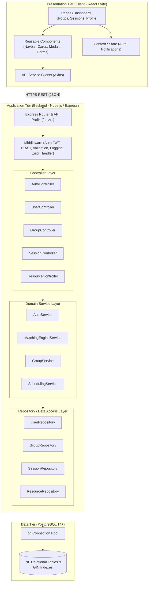

# StudySync: Comprehensive Project Planning & Engineering Management Document

**Course:** Software Engineering & Project Management (SEPM)  
**Project Title:** StudySync — Peer Matching & Collaborative Study Group Platform  
**Model:** Incremental Development Model organized via Agile Scrum  
**Document Version:** 1.0.0 (Phase 0 Planning Baseline)  
**Target Submission Milestone:** Mid-Semester Evaluation (40–60% Completion Target) & Final Delivery  

---

## Table of Contents
1. [Project Definition & Objectives](#1-project-definition--objectives)
2. [Scope, Assumptions, and Constraints](#2-scope-assumptions-and-constraints)
3. [SDLC & Agile Scrum Methodology](#3-sdlc--agile-scrum-methodology)
4. [Increment & Sprint Plan](#4-increment--sprint-plan)
5. [Four-Member Responsibility Matrix](#5-four-member-responsibility-matrix)
6. [Shared Technical Contracts & Engineering Conventions](#6-shared-technical-contracts--engineering-conventions)
7. [System Architecture & Module Boundaries](#7-system-architecture--module-boundaries)
8. [Requirements Traceability & Verification Process](#8-requirements-traceability--verification-process)
9. [Software Engineering Diagrams & Course PDF Deliverables Mapping](#9-software-engineering-diagrams--course-pdf-deliverables-mapping)
10. [Quality Management, Risk Register, and Release Checklist](#10-quality-management-risk-register-and-release-checklist)

---

## 1. Project Definition & Objectives

### 1.1 Problem Statement
Higher education students consistently struggle to identify compatible study peers and form productive academic groups. Existing communication channels (e.g., ad-hoc WhatsApp groups, Discord channels, or email lists) lack structured discovery, schedule alignment, course-specific context, and accountability mechanisms. Consequently, students face:
- **Fragmented Peer Discovery:** Inability to find peers taking the exact same courses or facing identical academic challenges.
- **Schedule Incompatibilities:** High coordination overhead to reconcile lecture times, labs, and personal commitments.
- **Asymmetric Commitment & Inactive Groups:** Unmonitored groups suffer from "free-riding," lack of session structure, and lost study resources.

### 1.2 Proposed Solution: StudySync
StudySync is a centralized, full-stack web platform enabling university students to discover academic peers, join curated study groups, coordinate structured study sessions with calendar synchronization, share relevant learning resources, and monitor their attendance and participation history.

### 1.3 Project Objectives
- **Obj-1 (Peer & Group Discovery):** Provide a multi-criteria search and matching engine evaluating course subjects, student learning goals, and weekly schedule availability.
- **Obj-2 (Structured Membership Management):** Implement an access-controlled workflow allowing group creation, join requests, creator approval, and membership caps.
- **Obj-3 (Conflict-Free Scheduling):** Support calendar scheduling with automated conflict detection, calendar views, and attendee RSVP status tracking.
- **Obj-4 (Shared Resource Repository):** Provide a centralized repository for session notes, reference URLs, and study materials indexed by group and topic.
- **Obj-5 (Participation Accountability):** Maintain an unalterable history of student session attendance and active group contributions.
- **Obj-6 (SEPM Compliance & Quality):** Demonstrate rigorous software engineering practices, 100% requirements-to-test traceability, zero security credential leaks, and complete adherence to the course evaluation criteria.

---

## 2. Scope, Assumptions, and Constraints

### 2.1 In-Scope Features
- **Student Authentication & Role-Based Access Control (RBAC):** JWT-based secure authentication, registration, login, and authorization (`student`, `admin`, `group_owner`, `group_member`).
- **Student Profile & Preferences:** Major, year, bio, learning goals, preferred course subjects, and structured weekly recurring availability slots.
- **Study Group Creation & Discovery:** Creation of course-focused public and private groups, group directory, search, filtering by subject and tags, and membership capacity limits.
- **Explainable Peer & Group Matching:** Heuristic matching algorithm computing a weighted compatibility score based on subject overlap (40%), schedule availability overlap (40%), and learning goals alignment (20%).
- **Membership Request Workflow:** Application submissions, acceptance/rejection by group owners, and roster maintenance.
- **Study Session Scheduling:** Session creation, date/time boundaries, recurring/one-time meetings, online meeting links or physical venues, and RSVP status (`attending`, `declined`, `tentative`, `attended`).
- **Resource Repository:** Upload and sharing of study links, documents, and notes tagged by group.
- **Participation History:** Student dashboard displaying personal sessions attended, upcoming meetings, and enrolled groups.

### 2.2 Explicit Exclusions (Out of Scope)
- Real-time video/audio conferencing server implementation (the platform integrates external video links such as Zoom/Google Meet).
- Direct peer-to-peer real-time chat with WebSockets (deferred to post-v1; focus is on structured scheduling, resources, and async coordination).
- Payment gateways, paid tutoring transactions, or monetary compensation systems.
- University Registrar/LMS auto-import integration (mock course catalogue used for demonstration).

### 2.3 Assumptions
- Users access the platform via modern standards-compliant web browsers (Chrome, Firefox, Safari, Edge).
- All users belong to the academic community and hold valid email credentials.
- Timezone handling assumes standard UTC persistence with local client rendering.

### 2.4 Constraints
- **Tech Stack Compliance:** Frontend: React, Vite, Tailwind CSS, TypeScript; Backend: Node.js, Express.js REST APIs; Database: PostgreSQL.
- **Evaluation Timeline:** Strict Mid-Semester Evaluation milestone requiring 40–60% working progress and at least one end-to-end verified workflow.
- **Academic Integrity:** All team members must explain, demonstrate, and verify all code and design artifacts. Generative AI tool usage must be formally disclosed per Course Guidelines Section 6.

---

## 3. SDLC & Agile Scrum Methodology

### 3.1 Synthesis: Incremental Development Model Organized via Scrum
A common pitfall in software engineering coursework is confusing the **System Development Life Cycle (SDLC) process model** with the **Project Management Framework**:



- **Incremental Development Model (Engineering Strategy):** The software system is partitioned into independent, staged functional increments. Each increment delivers an operable subset of the complete system, progressing from core architectural scaffolding to complex peer matching and scheduling. This mitigates architectural risk early and guarantees a working baseline at the mid-semester checkpoint.
- **Agile Scrum (Team Execution Framework):** Scrum governs how the four-member team collaborates to build each increment. Time-boxed iterations (Sprints), daily coordination, product backlog grooming, Sprint Reviews, and Retrospectives ensure transparent progress, equal workload allocation, and continuous integration.

### 3.2 Scrum Artifacts & Ceremonies
1. **Product Backlog:** Prioritized list of all functional and non-functional user stories maintained in `docs/scrum/BACKLOG.md`.
2. **Sprint Backlog:** Sub-selection of stories committed for the active sprint, with estimated story points.
3. **Sprint Planning:** 60-minute meeting at the beginning of each sprint to agree on goals and task breakdown.
4. **Daily Standup / Coordination:** 15-minute asynchronous or synchronous sync:
   - What did I complete yesterday?
   - What will I complete today?
   - What blockers or contract dependencies exist?
5. **Sprint Review & Demo:** Working demonstration of increment features evaluated against acceptance criteria.
6. **Sprint Retrospective:** Review of team process, code review velocity, and continuous improvement actions.

### 3.3 Definition of Ready (DoR) and Definition of Done (DoD)

#### Definition of Ready (DoR)
A backlog story is Ready to be pulled into a sprint only when:
- [x] User story has clear "As a... I want to... So that..." phrasing.
- [x] Clear Acceptance Criteria (Given-When-Then format) are specified.
- [x] API contract and schema impact are identified and agreed upon by the affected members.
- [x] Story points and primary owner assigned.
- [x] Dependencies on preceding tables/endpoints are satisfied or mocked.

#### Definition of Done (DoD)
A story is marked Done only when:
- [x] Application code is written adhering strictly to project naming and architectural guidelines.
- [x] No secrets, test credentials, or temporary debug logs committed.
- [x] Unit/integration tests written with positive, negative, and boundary test cases.
- [x] Tests pass cleanly in the local and test environments.
- [x] Peer code review conducted and approved on a dedicated GitHub Pull Request.
- [x] Traceability updated in `TRACEABILITY_MATRIX.md` with requirement and test case IDs.
- [x] Working feature demonstrated and verified.

### 3.4 Git Branching, Pull Requests, and Merge Policy
- **Authoritative Branches:**
  - `main`: Production-ready, stable, deployable code only. Tagged with milestone releases (`v0.5.0-midsem`, `v1.0.0-final`).
  - `develop`: Integration branch where all sprint features converge.
- **Feature Branches:**
  - Naming: `feature/<issue-id>-<short-description>` (e.g., `feature/FR001-user-auth`, `feature/FR004-group-matching`).
  - Bug fixes: `fix/<issue-id>-<description>`.
- **Merge Policies:**
  - Direct pushes to `main` and `develop` are prohibited.
  - Every PR requires at least **one peer review approval** from another team member.
  - All automated tests and linter checks must pass prior to merge.
  - Squash and merge is encouraged to maintain a clean linear commit history.

---

## 4. Increment & Sprint Plan

### 4.1 Development Increments

```
+---------------------------------------------------------------------------------------------------+
| Phase 0: System Architecture, Planning & Baseline Initialization (Pre-implementation)             |
| Deliverables: SRS, Architecture Diagram, Database Schema, API Contracts, Repository Scaffold     |
+---------------------------------------------------------------------------------------------------+
                                                  |
                                                  v
+---------------------------------------------------------------------------------------------------+
| Increment 1: Foundation — Authentication, User Profiles, & Study Groups                           |
| Deliverables: JWT Auth, Student Profile Setup, Subject Catalog, Study Group Creation & Discovery |
+---------------------------------------------------------------------------------------------------+
                                                  |
                                                  v  [MID-SEMESTER EVALUATION CHECKPOINT (40-60%)]
+---------------------------------------------------------------------------------------------------+
| Increment 2: Core Matching Engine & Membership Workflow                                           |
| Deliverables: Heuristic Peer/Group Matching, Join Requests, Owner Approvals, Capacity Enforcement|
+---------------------------------------------------------------------------------------------------+
                                                  |
                                                  v
+---------------------------------------------------------------------------------------------------+
| Increment 3: Scheduling, Resource Sharing, & Attendance Tracking                                  |
| Deliverables: Conflict-Free Session Calendar, RSVP Workflow, Resource Catalog, Attendance History|
+---------------------------------------------------------------------------------------------------+
                                                  |
                                                  v
+---------------------------------------------------------------------------------------------------+
| Increment 4: End-to-End System Integration, Security Hardening, & Final Submission Release         |
| Deliverables: System Integration Tests, Performance Validation, Video Demo, Final Project Report |
+---------------------------------------------------------------------------------------------------+
```

### 4.2 Sprint Schedule & Milestone Alignment
Assuming standard academic cadence across 4 two-week sprint cycles:

| Sprint | Focus & Increment | Target Deliverables | Mid-Sem Progress |
| :--- | :--- | :--- | :--- |
| **Sprint 1** | **Phase 0 & Increment 1** | Environment setup, DB migrations, JWT Auth, Profile CRUD, Subject catalog, Group creation & browsing. | ~25% |
| **Sprint 2** | **Increment 1 Completion & Increment 2 Baseline** | Group membership request/approval, Capacity guards, Basic matching algorithm, End-to-End working flow (Register -> Profile -> Create Group -> Join Group). Mid-Sem Report & Video Demo! | **50% (Mid-Sem Target Satisfied)** |
| **Sprint 3** | **Increment 2 Polish & Increment 3** | Advanced schedule-overlap matching algorithm, Study Session scheduling with overlap validation, Shared resource uploads, Attendance check-in. | ~80% |
| **Sprint 4** | **Increment 4 & Final QA** | End-to-end regression testing, UI responsive polishing, defect remediation, comprehensive documentation, final video demonstration. | **100% (Final Release)** |

> [!IMPORTANT]
> **Mid-Semester Requirement Compliance:** Course PDF Section 1 & 2 mandates demonstrating **40–60% progress** and **at least one working end-to-end feature**. The end of Sprint 2 delivers the complete **Student Authentication → Profile Registration → Group Creation & Discovery → Join Request** pipeline, fulfilling every mid-sem criterion.

---

## 5. Four-Member Responsibility Matrix

The workload is balanced equally among all four team members according to architectural tiers and functional specialization:

```mermaid
graph LR
    subgraph Member1["Member 1: Frontend & UI/UX"]
        M1A["React UI Pages & Components"]
        M1B["Tailwind Design System & Responsive Layouts"]
        M1C["API Service Client & State Management"]
        M1D["Frontend Form Validation & UI Tests"]
    end

    subgraph Member2["Member 2: Backend & Authentication"]
        M2A["Express App Architecture & Router"]
        M2B["JWT Authentication & RBAC Middleware"]
        M2C["Centralized Error & Response Envelope"]
        M2D["User & Auth REST API Endpoints"]
    end

    subgraph Member3["Member 3: Database & Peer Matching"]
        M3A["PostgreSQL 3NF Schema & Migrations"]
        M3B["Data Integrity, Foreign Keys & Indexes"]
        M3C["Seed Test Data & Data Dictionary"]
        M3D["Heuristic Peer Matching Algorithm"]
    end

    subgraph Member4["Member 4: Scheduling, Resources & QA"]
        M4A["Study Session Scheduling & Time Boundaries"]
        M4B["Attendance Tracking & RSVP Management"]
        M4C["Resource Repository & Metadata Service"]
        M4D["Quality Assurance, Traceability & E2E Testing"]
    end

    Member1 <--> Member2
    Member2 <--> Member3
    Member2 <--> Member4
    Member3 <--> Member4
    Member4 -.-> Member1
```



### Detailed Allocation Table

| Team Member | Primary Specialization | Key Deliverables | Shared Collaboration Dependencies |
| :--- | :--- | :--- | :--- |
| **Member 1** | **Frontend & UI/UX** | - React (Vite) + Tailwind CSS application pages.<br>- Component hierarchy (Navbar, GroupCard, CalendarView, ProfileForm).<br>- Client-side routing with React Router.<br>- State management (AuthContext, GroupContext).<br>- Client-side validation, error banners, loading spinners.<br>- Component tests via Vitest & React Testing Library. | Relies on Member 2 for Auth API contracts; relies on Member 3 & 4 for Group and Session API payload contracts. |
| **Member 2** | **Backend Architecture & Authentication** | - Express server architecture, routing pipelines, middleware.<br>- Secure JWT token generation, verification, and revocation.<br>- Password hashing via bcrypt (cost factor 10).<br>- Centralized error handling and standardized JSON response wrapper.<br>- User registration, login, profile management REST endpoints.<br>- Integration tests for Auth APIs via Supertest. | Coordinates with Member 3 for User/Profile DB schema; provides token middleware for Members 3 & 4 routes. |
| **Member 3** | **Database Engineering & Matching Engine** | - PostgreSQL DDL migrations (`database/migrations/`).<br>- Referential integrity, cascading deletes, check constraints, GIN indexes.<br>- Realistic seed datasets (`database/seeds/`).<br>- Data Dictionary and ER diagram maintenance.<br>- Peer and Study-Group matching logic (subject overlap, schedule compatibility, learning goals).<br>- Matching accuracy unit & benchmark tests. | Relies on Member 2 for User IDs; supplies DB pool repository methods to Members 2 & 4. |
| **Member 4** | **Scheduling, Resources & System QA** | - Study Session scheduling endpoints and conflict detection validation.<br>- Session attendee RSVP and attendance tracking logic.<br>- Shared resource upload/link management and metadata indexing.<br>- System QA: Test Plan, Test Case Register (`TC-001` to `TC-030`), Defect Log.<br>- Traceability Matrix updates and Mid-Sem Demo coordination. | Consumes DB models from Member 3; integrates routes into Member 2's Express app; validates frontend UX with Member 1. |

### Collective Decisions (Must Not Be Made Unilaterally)
The following decisions require explicit team consensus:
1. Modifications to the REST API URI paths or JSON request/response envelopes.
2. Alterations to PostgreSQL table names, column types, or foreign key rules.
3. Addition of external third-party libraries or build tooling.
4. Changes to story point estimates or sprint scope commitments.

---

## 6. Shared Technical Contracts & Engineering Conventions

### 6.1 Language & Framework Selection
- **Frontend:** React 18, Vite, TypeScript, Tailwind CSS. TypeScript provides strict type checking matching backend response types.
- **Backend:** Node.js 18+ LTS, Express 4.x (ES Modules with standard ECMAScript imports), PostgreSQL client (`pg`).
- **Validation:** Zod for type-safe runtime schema validation on both incoming request bodies and query parameters.
- **Testing:** Frontend: Vitest + React Testing Library; Backend: Jest + Supertest; Database: SQL verification scripts.

### 6.2 Standardized REST API Envelopes
Every API endpoint must respond using the uniform response envelope to guarantee deterministic consumption by the frontend.

#### Success Envelope (`200 OK`, `201 Created`)
```json
{
  "success": true,
  "message": "Study group created successfully",
  "data": {
    "id": "44444444-4444-4444-4444-444444444401",
    "name": "SE301 Architecture Study Circle",
    "subjectCode": "CS301",
    "maxMembers": 6,
    "currentMemberCount": 1,
    "createdAt": "2026-10-16T13:00:00.000Z"
  },
  "meta": {
    "page": 1,
    "limit": 20,
    "total": 1,
    "totalPages": 1
  },
  "error": null
}
```

#### Error Envelope (`400 Bad Request`, `401 Unauthorized`, `404 Not Found`, `409 Conflict`, `500 Internal Error`)
```json
{
  "success": false,
  "data": null,
  "error": {
    "code": "VALIDATION_ERROR",
    "message": "Invalid input parameters provided",
    "details": [
      {
        "field": "endTime",
        "message": "Session end time must be chronologically after start time"
      }
    ]
  }
}
```

### 6.3 Authentication & Session Management
- **Token Mechanism:** Stateless JSON Web Token (JWT) signed with HMAC-SHA256.
- **Token Transmission:** HTTP header `Authorization: Bearer <token>`.
- **Token Payload:**
  ```json
  {
    "userId": "22222222-2222-2222-2222-222222222201",
    "email": "alice.chen@university.edu",
    "role": "student",
    "iat": 1729080000,
    "exp": 1729166400
  }
  ```
- **Password Security:** Salted and hashed using `bcrypt` with cost factor 10. Cleartext passwords are never logged or stored.

### 6.4 Date, Time, and Availability Conventions
- **Database & API Storage:** Always in UTC following ISO 8601 (`YYYY-MM-DDTHH:mm:ss.sssZ`).
- **Student Recurring Weekly Availability Format:**
  Stored as JSONB array of normalized weekly day/time intervals:
  ```json
  [
    { "dayOfWeek": "monday", "startTime": "14:00", "endTime": "17:00" },
    { "dayOfWeek": "wednesday", "startTime": "10:00", "endTime": "12:00" }
  ]
  ```

### 6.5 Database Naming & Migration Conventions
- Tables and column names: `snake_case` (e.g., `user_profiles`, `created_by_id`, `start_time`).
- Primary keys: UUID v4 named `id`.
- Foreign keys: `<singular_table>_id` (e.g., `group_id`, `user_id`).
- Timestamps: `created_at`, `updated_at` with time zone (`TIMESTAMP WITH TIME ZONE`).

---

## 7. System Architecture & Module Boundaries

The StudySync system implements a strict **Three-Tier Layered Architecture** with distinct module boundaries:



### Module Boundary Rules
1. **Controller Layer:** Only parses HTTP request parameters/headers, calls Zod validators, invokes the appropriate Service, and formats the response envelope. Contains zero business logic or direct SQL.
2. **Service Layer:** Encapsulates core business rules (matching algorithms, membership capacity checks, schedule overlap collision logic). Agnostic of Express `req`/`res` objects.
3. **Repository Layer:** The only layer executing SQL queries against the PostgreSQL connection pool. Returns clean domain entities or throws structured database errors.
4. **Client Services:** Frontend calls all backend APIs through centralized services (`src/services/api.ts`) rather than direct `fetch` calls scattered across components.

---

## 8. Requirements Traceability & Verification Process

StudySync enforces an end-to-end traceability chain:
$$\text{Requirement ID} \longrightarrow \text{SRS} \longrightarrow \text{UML Design} \longrightarrow \text{Implementation Module} \longrightarrow \text{Test Case ID} \longrightarrow \text{Verification Result}$$

Every feature must possess an unbroken lineage documented in `docs/requirements/TRACEABILITY_MATRIX.md`.

### Core Requirements Register Summary

| Req ID | Type | Title | MoSCoW | Increment | Primary Owner | Target Test Case |
| :--- | :--- | :--- | :--- | :--- | :--- | :--- |
| **FR-001** | Functional | Student Registration & Password Hashing | Must Have | Inc 1 | Member 2 | `TC-001`, `TC-002` |
| **FR-002** | Functional | JWT Login & Session Authentication | Must Have | Inc 1 | Member 2 | `TC-003`, `TC-004` |
| **FR-003** | Functional | Profile Setup & Schedule Availability | Must Have | Inc 1 | Member 2 / 1 | `TC-005` |
| **FR-004** | Functional | Study Group Creation with Capacity Limits | Must Have | Inc 1 | Member 3 / 2 | `TC-006`, `TC-007` |
| **FR-005** | Functional | Study Group Search & Subject Filtering | Must Have | Inc 1 | Member 1 / 3 | `TC-008` |
| **FR-006** | Functional | Membership Request & Owner Approval | Must Have | Inc 2 | Member 3 / 2 | `TC-009`, `TC-010` |
| **FR-007** | Functional | Peer & Group Compatibility Matching | Should Have | Inc 2 | Member 3 | `TC-011`, `TC-012` |
| **FR-008** | Functional | Study Session Creation & Overlap Guard | Must Have | Inc 3 | Member 4 | `TC-013`, `TC-014` |
| **FR-009** | Functional | Session Attendance RSVP & Check-in | Should Have | Inc 3 | Member 4 | `TC-015` |
| **FR-010** | Functional | Study Resource Upload & Metadata Index | Should Have | Inc 3 | Member 4 | `TC-016` |
| **NFR-001**| Non-Functional | Secure Password Storage (bcrypt cost 10) | Must Have | Inc 1 | Member 2 | `TC-017` |
| **NFR-002**| Non-Functional | Sub-200ms API Response for Search Queries | Should Have | Inc 2 | Member 3 | `TC-018` |
| **NFR-003**| Non-Functional | Responsive UI across Desktop & Mobile | Must Have | Inc 1-4 | Member 1 | `TC-019` |
| **NFR-004**| Non-Functional | Relational Integrity & Zero Orphan Records| Must Have | Inc 1-3 | Member 3 | `TC-020` |

---

## 9. Software Engineering Diagrams & Course PDF Deliverables Mapping

### 9.1 Course PDF Deliverables Concordance Table
The Course PDF outlines strict submission criteria for the Mid-Semester Evaluation. The table below maps each mandatory item to its authoritative repository location:

| PDF Requirement | Course PDF Section | Required Deliverable | Repository Source / Document |
| :--- | :--- | :--- | :--- |
| **Mid-Sem Project Report** | Section 3.A (16 items) | 10–15 page PDF report | `docs/reports/MIDSEM_REPORT_TEMPLATE.md` (to be exported as `MidSem_Project_Report.pdf`) |
| **Requirements Specification**| Section 3.C | SRS document | `docs/requirements/SRS.md` |
| **Use-Case Model** | Section 3.C | Use Case Diagram & Specs | `docs/diagrams/use_case_diagram.mermaid` & `docs/diagrams/use_case_descriptions.md` |
| **System Architecture** | Section 3.C | Architecture Diagram | `docs/diagrams/system_architecture.mermaid` & `docs/architecture/SYSTEM_ARCHITECTURE.md` |
| **Database Design** | Section 3.C | ER Diagram & Schema | `docs/diagrams/er_diagram.mermaid` & `database/schema/schema_documentation.md` |
| **UML Diagrams** | Section 3.C | Sequence & Activity | `docs/diagrams/sequence_diagrams.mermaid` & `docs/diagrams/activity_diagram.mermaid` |
| **Source Code & Setup** | Section 3.B | Running source snapshot | `frontend/`, `backend/`, `database/`, root `README.md` |
| **Testing Deliverables** | Section 3.C, 11 | Test Cases & Evidence | `docs/testing/TEST_PLAN.md`, `docs/testing/TEST_CASES.md` |
| **Project Management** | Section 3.E | Plan, Logs, Contributions | `docs/PROJECT_PLAN.md`, `docs/scrum/MEETING_LOG.md`, `docs/scrum/CONTRIBUTION_RECORD.md` |
| **Demonstration Video** | Section 3.D | 5–7 min video link | `DEMO_VIDEO_LINK.txt` & `docs/reports/DEMO_VIDEO_GUIDE.md` |
| **AI Tool Disclosure** | Section 6 | AI usage statement | `docs/reports/AI_USAGE_DISCLOSURE.md` |
| **Moodle Submission ZIP** | Section 4 & 5 | `Section_Group_Title.zip` | Prepared via structure defined in `docs/reports/SUBMISSION_ZIP_SPEC.md` |

---

## 10. Quality Management, Risk Register, and Release Checklist

### 10.1 Key Risks & Mitigation Matrix

| Risk ID | Risk Description | Severity | Probability | Mitigation Strategy |
| :--- | :--- | :--- | :--- | :--- |
| **RSK-01** | **API Contract Divergence:** Frontend and Backend teams develop against mismatched endpoint paths or payloads. | High | Medium | Define authoritative contracts in `docs/api/API_SPECIFICATION.md` before coding. Any contract alteration requires peer approval. |
| **RSK-02** | **Direct Database Mutation:** Developers alter local DB schema without committing migrations, causing broken builds. | High | Medium | Schema changes strictly controlled by Member 3 through numbered SQL migration scripts. |
| **RSK-03** | **Mid-Sem End-to-End Failure:** Separate components exist in isolation but no complete user journey functions. | Critical | Low | Prioritize Increment 1 integration in Sprint 1. Validate the Register → Group Creation pipeline 5 days before evaluation. |
| **RSK-04** | **Scheduling Conflict False Negatives:** Algorithm fails to detect overlapping study sessions across members. | Medium | Medium | Unit test scheduling boundary edge cases (adjacent times, exact overlap, contained intervals). |
| **RSK-05** | **Unequal Contribution Record:** Imbalanced git commits lead to course mark deduction. | High | Low | Enforce task allocation matrix; every member owns distinct vertical deliverables and records weekly logs. |
| **RSK-06** | **Credential Leak:** Hardcoding DB passwords or JWT secret keys in repository files. | Critical | Low | Strict `.gitignore`, pre-commit verification, and `.env.example` templates with placeholder values. |

### 10.2 Final Release Verification Checklist
Before submitting the Mid-Semester package or final release, the team must verify:
- [ ] At least one working end-to-end feature demonstrated without crashing.
- [ ] No `TODO` comments or unhandled promise rejections in core workflows.
- [ ] Zero secrets, private tokens, or real credentials in Git history.
- [ ] All database migrations run cleanly on an empty database.
- [ ] Test-case register contains actual executed pass/fail results with evidence screenshots.
- [ ] Demonstration video is 5–7 minutes, clear audio/video, accessible view-only link in `DEMO_VIDEO_LINK.txt`.
- [ ] AI disclosure document completed per Course PDF Section 6.
- [ ] ZIP file named precisely `Section_GroupNumber_StudySync_MidSem.zip` adhering to 7-folder layout.
